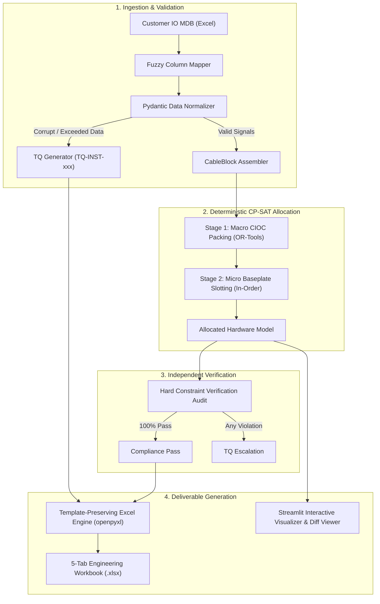
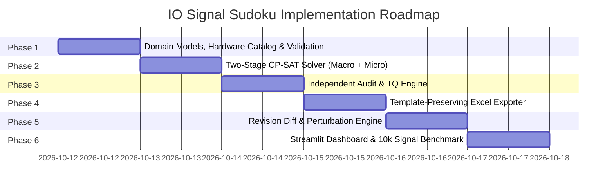

# Complete Implementation Specification: IO Signal Sudoku

**System:** Emerson DeltaV Electronic Marshalling Automated Allocation & Revision Management Engine  
**Version:** 1.0.0-PROD  
**Target:** Smart India Hackathon (SIH) / Industrial Control Systems Engineering Deliverable  

---

## 1. Executive Summary & Design Invariants

**IO Signal Sudoku** transforms manual, error-prone spreadsheet allocation of 10,000+ industrial instrumentation field signals into a deterministic, mathematically optimal, and audit-compliant allocation inside Emerson DeltaV CHARM hardware.



### Core Invariants (Non-Negotiable)
1. **Mathematical Determinism:** Allocation logic relies strictly on Google OR-Tools CP-SAT and constraint programming. No probabilistic or hallucinations-prone LLMs in the allocation loop.
2. **Two-Stage Hierarchical Packing:** Grouping signals into rigid multi-conductor cable blocks (Stage 1) prevents combinatorial explosion; in-baseplate slot assignment (Stage 2) guarantees contiguous pair order.
3. **Linearized Indicator Segregation Cuts:** Train A and Train B duty/standby safety rules are enforced at CIOC level ($U_c^A + U_c^B \le 1$) rather than $O(N^2)$ pairwise exclusion variables.
4. **Independent Post-Solve Audit:** 100% of physical and safety constraints are verified by a standalone validator before writing any output.
5. **Exact Template Fidelity:** The original customer Excel template structure, cell styles, formatting, and formulas are preserved intact using openpyxl.
6. **Graceful Degradation via Formal TQs:** Any corrupt row, capacity overflow, or contradiction triggers an official Technical Query (`TQ-INST-xxx`) without crashing.

---

## 2. System Architecture & Directory Structure

```
C:\Users\Asus\Desktop\VIT Project\
├── .agents/skills/                    # Installed agent skills
│   ├── algorithm-design/
│   ├── constraint-driven-development/
│   ├── fastapi/
│   ├── networkx/
│   ├── pymoo/
│   ├── python-design-patterns/
│   ├── python-testing-patterns/
│   └── xlsx/
├── .scratch/                          # Specifications and local issue tracking
│   └── io-signal-sudoku/
│       ├── spec.md                    # This document
│       └── issues/                    # Phase tickets (01 to 06)
├── config/                            # Versioned rule presets & hardware catalogs
│   ├── deltav_hardware_catalog.json  # CHARM & Terminal block mapping table
│   └── default_rules.yaml             # Grouping, A/B segregation, spare margins, naming
├── src/                               # Application source code
│   ├── __init__.py
│   ├── domain/                        # Pure domain models (immutable dataclasses / Pydantic)
│   │   ├── __init__.py
│   │   ├── models.py                  # Signal, Cable, CableBlock, CHARM, Baseplate, CIOC, Cabinet
│   │   ├── hardware.py                # DeltaV hardware catalog & TB selector
│   │   └── rules.py                   # Engineering rule definitions & validation schemas
│   ├── ingestion/                     # Ingestion, column mapping & sanitization
│   │   ├── __init__.py
│   │   ├── mapper.py                  # Regex & synonym column auto-mapper
│   │   ├── parser.py                  # Excel reader & row normalizer
│   │   └── validator.py               # Pre-solver sanity checker & TQ emitter
│   ├── solver/                        # Deterministic CP-SAT optimization engine
│   │   ├── __init__.py
│   │   ├── macro_packer.py            # Stage 1: CableBlock-to-CIOC assignment
│   │   ├── micro_slotter.py           # Stage 2: Contiguous in-baseplate slotting
│   │   ├── revision_engine.py         # Rev A vs Rev B weighted perturbation solver
│   │   └── audit.py                   # Independent rule compliance verifier
│   ├── export/                        # Deliverables generation
│   │   ├── __init__.py
│   │   ├── template_overlay.py        # openpyxl template-preserving writer
│   │   ├── report_generator.py        # Multi-tab workbook builder (TQ, Summary, Audit, Diff)
│   │   └── metrics.py                 # Cabinet fill & spare percentage calculators
│   └── ui/                            # Streamlit frontend dashboard
│       ├── __init__.py
│       ├── app.py                     # Main dashboard entrypoint
│       ├── components/                # Reusable UI widgets
│       │   ├── file_uploader.py       # Dual uploader (IO MDB + Template / Rev A + Rev B)
│       │   ├── mapping_review.py      # Column confirmation preview table
│       │   ├── rule_panel.py          # Interactive rule sliders & hardware editor
│       │   ├── cabinet_visualizer.py  # Plotly CIOC & Baseplate DIN rail rack view
│       │   └── diff_viewer.py         # Rev A vs Rev B color-coded delta viewer
├── tests/                             # Comprehensive test suite (pytest)
│   ├── test_ingestion.py              # Column mapping & TQ generation tests
│   ├── test_hardware.py               # CHARM & Terminal Block selection tests
│   ├── test_macro_packer.py           # Stage 1 CP-SAT capacity & segregation tests
│   ├── test_micro_slotter.py          # Stage 2 contiguity & pair-order tests
│   ├── test_audit.py                  # Invariant validator tests
│   ├── test_revision_engine.py        # Rev B perturbation metric tests
│   ├── test_export.py                 # Excel template fidelity & multi-tab tests
│   └── test_stress_10k.py             # Performance benchmark on 10,000 synthetic signals
├── data/                              # Sample & benchmark datasets
│   ├── sample_io_mdb.xlsx             # Customer input database
│   ├── sample_template.xlsx           # Customer output blank template
│   ├── sample_rev_b.xlsx              # Revision test file
│   └── generate_sample_data.py        # Script generating 10,000 realistic instrument loops
├── requirements.txt                   # Production dependencies
└── README.md                          # User & evaluator quickstart guide
```

---

## 3. Detailed Component Specifications

### 3.1 Domain Models & Physical Invariants (`src/domain/`)

```python
# Physical Container Hierarchy
CHARMS_PER_BASEPLATE = 12
BASEPLATES_PER_CIOC = 8       # 96 CHARMs per CIOC
CIOCS_PER_CABINET = 4         # 384 CHARMs per single-sided cabinet (or 8 dual-sided)
```

- **`Signal`**: Represents one instrument loop.
  - Fields: `tag`, `io_type` (AI, AO, DI, DO, RTD, TC), `cable_id`, `pair_no`, `io_group`, `segregation` ('A' | 'B' | None), `description`, `rev_status` ('UNCHANGED' | 'MODIFIED' | 'ADDED' | 'DELETED').
- **`CableBlock`**: Rigid multi-conductor bundle (2, 6, 12, or 24 pairs).
  - All pairs within a cable must land contiguously on physical baseplates in strict ascending pair order.
  - Example: A 24-pair cable occupies 2 consecutive baseplates ($12 + 12$ slots), accommodating 22 signals + 2 wired spares.
- **`HardwareMapping`**: Emerson DeltaV CHARM & Terminal Block lookup:
  - `AI (4-20mA HART)` $\to$ Analog Input CHARM + Standard Terminal Block.
  - `TC (Thermocouple)` $\to$ TC/RTD CHARM + CJC (Cold Junction Compensation) Terminal Block.
  - `DO (Solenoid Valve 24VDC 1.0A)` $\to$ DO 24VDC High-Side CHARM + Fused Injected-Power Terminal Block.
  - `DO (Dry Contact)` $\to$ Relay Output CHARM + Relay Form C Terminal Block.

### 3.2 Ingestion & Fault-Tolerant TQ Generation (`src/ingestion/`)

1. **Fuzzy/Regex Mapping Table**:
   - `Tag`: `["tag", "instrument_tag", "tag_no", "tagname", "loop_tag"]`
   - `IO_Type`: `["io_type", "signal_type", "type", "io", "channel_type"]`
   - `Cable_ID`: `["cable_id", "cable_no", "cable", "trunk_cable", "multicore"]`
   - `Pair_No`: `["pair_no", "pair", "pair_number", "wire_pair", "pair_id"]`
   - `IO_Group`: `["io_group", "group", "grp", "unit", "area", "system"]`
   - `Segregation`: `["segregation", "seg", "train", "redundancy", "channel_seg"]`
2. **Pre-Solve Technical Query (TQ) Emitter**:
   Emits structured records before solver invocation:
   - `TQ-VAL-001`: Missing required field (`Tag` or `IO_Type`).
   - `TQ-VAL-002`: Duplicate `Tag` detected across rows.
   - `TQ-VAL-003`: Declared pair number exceeds cable capacity (e.g. Pair 25 on 24-pair cable).
   - `TQ-VAL-004`: Cable contains conflicting segregation classifications (e.g. Train A and Train B in same cable bundle).
   - `TQ-VAL-005`: Unknown/unsupported IO signal type.

### 3.3 Two-Stage CP-SAT Allocation Engine (`src/solver/`)

#### Stage 1: Macro CIOC Packing (Bin Packing with Indicator Cuts)
- **Decision Variable**: $Y_{k, c} \in \{0, 1\}$ (CableBlock $k$ assigned to CIOC $c$).
- **Capacity Constraint**:
  $$\sum_{k} \text{Size}(k) \cdot Y_{k, c} \le 96 \cdot (1 - \text{SpareMargin}) \quad \forall \text{ CIOC } c$$
- **Linearized Segregation Cuts**:
  Let $U_c^A, U_c^B \in \{0, 1\}$ indicate presence of Train A or Train B signals on CIOC $c$:
  $$Y_{k, c} \le U_c^A \quad \forall k \in \text{Cables}_A, \quad Y_{k, c} \le U_c^B \quad \forall k \in \text{Cables}_B$$
  $$U_c^A + U_c^B \le 1 \quad \forall c$$
- **Objective**: Minimize number of activated cabinets and CIOCs while grouping signals with the same `io_group` within the same cabinet.

#### Stage 2: Micro Baseplate & Slot Allocation (In-Order Contiguity)
- Within each CIOC, CableBlocks are placed onto Baseplates (1 to 8):
  - 24-pair cables occupy 2 full consecutive baseplates.
  - 12-pair cables occupy 1 full baseplate.
  - 6-pair and 2-pair cables occupy contiguous slot sub-ranges.
  - Pairs are assigned strictly to slots $p_1, p_2, \dots$ in ascending order; empty/unallocated pairs within the trunk are explicitly labeled as `WIRED SPARE`.

### 3.4 Revision Perturbation Engine (`src/solver/revision_engine.py`)

When processing Rev B against Rev A:
1. **Diff Classifier**: Categorizes signals into `UNCHANGED`, `MODIFIED` (IO type/group changed), `DELETED` (vacated slot), and `ADDED` (needs placement).
2. **Anchor Strategy**:
   - Every `UNCHANGED` signal is pinned to its exact Rev A slot ($X_{s, p} = 1$).
   - Holes created by `DELETED` signals are indexed as candidate free slots.
3. **Weighted Minimization Objective**:
   $$\min \sum_{s \in \text{Rev B}} \left( 10000 \cdot \Delta_{\text{cabinet}}(s) + 1000 \cdot \Delta_{\text{CIOC}}(s) + 100 \cdot \Delta_{\text{baseplate}}(s) + 10 \cdot \Delta_{\text{slot}}(s) \right)$$
   This ensures new signals preferentially backfill vacated slots in the original CIOC/Cabinet before requiring new physical hardware.

### 3.5 Independent Post-Solve Audit Pass (`src/solver/audit.py`)

A separate validation module reads the proposed allocation dictionary and verifies:
- [x] **Invariant 1:** No two signals share the same physical slot.
- [x] **Invariant 2:** No baseplate exceeds 12 CHARMs.
- [x] **Invariant 3:** No CIOC exceeds 8 baseplates.
- [x] **Invariant 4:** Train A and Train B signals never reside on the same CIOC.
- [x] **Invariant 5:** Every multi-pair cable occupies contiguous slots in exact ascending pair order.
- [x] **Invariant 6:** Every signal has a valid CHARM and Terminal Block assigned matching the hardware catalog.
- [x] **Invariant 7:** Cabinet spare capacity meets or exceeds the user-configured percentage.

### 3.6 Template-Preserving Excel Exporter (`src/export/`)

Using `openpyxl`:
1. If a customer template is uploaded, open the template in memory.
2. Write allocated signals into the designated data sheet starting at row 2, populating columns:
   `[Tag, IO Type, Cabinet, CIOC, Baseplate, Slot, CHARM Part No, Terminal Block Type, Cable ID, Pair No, Segregation, Status]`.
3. Append standard engineering deliverables as new formatted tabs:
   - **`Sheet 1: Allocation`** (Populated customer template with cell styles preserved).
   - **`Sheet 2: TQ_Log`** (Formal Technical Queries with TQ ID, Category, Severity, Impacted Tag, Description, Recommended Action).
   - **`Sheet 3: Cabinet_Summary`** (Cabinet-by-cabinet breakdown: total channels, used slots, wired spares, available spares, utilization %).
   - **`Sheet 4: Rule_Compliance_Audit`** (Checklist of verified invariants with pass/fail counts).
   - **`Sheet 5: Revision_Impact_Diff`** (If Rev B: breakdown of added, deleted, moved signals, and total $\Delta$ perturbation score).

### 3.7 Interactive Streamlit Dashboard (`src/ui/`)

- **Tab 1: Ingestion & Column Mapping**:
  - Drag-and-drop file upload for IO MDB and Blank Template.
  - Interactive table displaying detected column mappings with override dropdowns.
  - Data preview and pre-solve TQ summary counter.
- **Tab 2: Rule Configuration Panel**:
  - Sliders for Spare Margin (e.g. 10% – 30%).
  - Toggles for A/B Redundancy Segregation (CIOC vs Cabinet level).
  - Editable data editor for CHARM & Terminal Block selection matrix.
  - Naming pattern string builders (e.g. `CAB-{CAB_ID}-CIOC-{CIOC_ID}`).
- **Tab 3: Allocation Execution & Metrics**:
  - "Run Optimization" action button with live CP-SAT progress bar and solve-time telemetry.
  - High-level KPI metric cards: Total Signals, Cabinets Used, Average Utilization %, Spare Margin %, Zero Rule Violations badge.
  - Interactive Plotly DIN rail rack visualizer (color-coded by IO type, wired spare, or free slot).
- **Tab 4: Revision Comparison (Rev A vs Rev B)**:
  - Upload Rev B file.
  - Visual delta summary: Added (green), Deleted (red), Moved (orange), Perturbation Score $\Delta$.
- **Tab 5: Export & Reports**:
  - One-click download button for completed 5-tab Excel workbook (`.xlsx`).
  - Exportable TQ summary report.

---

## 4. Implementation Milestones & Work Breakdown



### Phase 1: Domain Models, Hardware Catalog & Ingestion
- **Ticket `01-domain-models-and-hardware-catalog.md`**: Pydantic models for `Signal`, `CableBlock`, `CIOC`, `Cabinet`; Emerson DeltaV CHARM & TB mapping dictionary.
- **Ticket `02-fuzzy-column-mapper-and-ingestion.md`**: Regex/synonym column auto-mapper, Excel reader, pre-solve validation, and synthetic data generator for testing.

### Phase 2: Two-Stage CP-SAT Allocation Engine
- **Ticket `03-macro-packer-cioc-assignment.md`**: CP-SAT Stage 1 model packing `CableBlock` bundles into CIOCs with linear indicator segregation cuts and spare margins.
- **Ticket `04-micro-slotter-baseplate-assignment.md`**: Stage 2 deterministic in-baseplate slotting maintaining contiguous pair orders and wired spares.

### Phase 3: Independent Invariant Audit & TQ Engine
- **Ticket `05-independent-rule-auditor.md`**: Standalone post-solve audit verifying all 7 physical & safety invariants.
- **Ticket `06-formal-tq-generation-system.md`**: Formal Technical Query generation with unique IDs (`TQ-INST-xxx`) for all unresolvable conflicts.

### Phase 4: Template-Preserving Excel Deliverable Exporter
- **Ticket `07-template-overlay-writer.md`**: `openpyxl` template cloner and data overlay engine preserving existing cell formatting and formulas.
- **Ticket `08-multi-tab-engineering-reports.md`**: Automated generation of `Allocation`, `TQ_Log`, `Cabinet_Summary`, and `Rule_Compliance` tabs.

### Phase 5: Revision Diff & Perturbation Minimization Engine
- **Ticket `09-revision-diff-classifier.md`**: Signal matcher comparing Rev A and Rev B to detect added, modified, deleted, and unchanged signals.
- **Ticket `10-weighted-perturbation-solver.md`**: CP-SAT minimization model anchoring unchanged signals and penalizing physical relocations.

### Phase 6: Streamlit Interactive UI & 10,000 Signal Benchmark
- **Ticket `11-streamlit-dashboard-and-visualizer.md`**: Interactive 5-tab Streamlit dashboard with Plotly DIN rail visualizers and rule editors.
- **Ticket `12-stress-benchmark-and-end-to-end-verification.md`**: End-to-end benchmark demonstrating sub-60-second execution on 10,000 signals with 0 rule violations.

---

## 5. Verification & Definition of Done

The system is considered complete when:
1. **Zero Hard Violations:** 100% of physical capacity, contiguous pair ordering, and A/B duty/standby segregation rules pass the independent audit on every test run.
2. **Template Fidelity:** Output files open in Microsoft Excel without corruption warnings, maintaining exact template styling and layout.
3. **Actionable TQs:** Any simulated corrupted row or over-capacity batch produces clear, structured TQ entries with suggested engineering remedies.
4. **Minimal Churn on Revisions:** Rev B preserves at least 95% of unchanged signal assignments and achieves minimal perturbation $\Delta$.
5. **Scale:** Full allocation of 10,000 signals completes within 60 seconds on standard laptop hardware.
